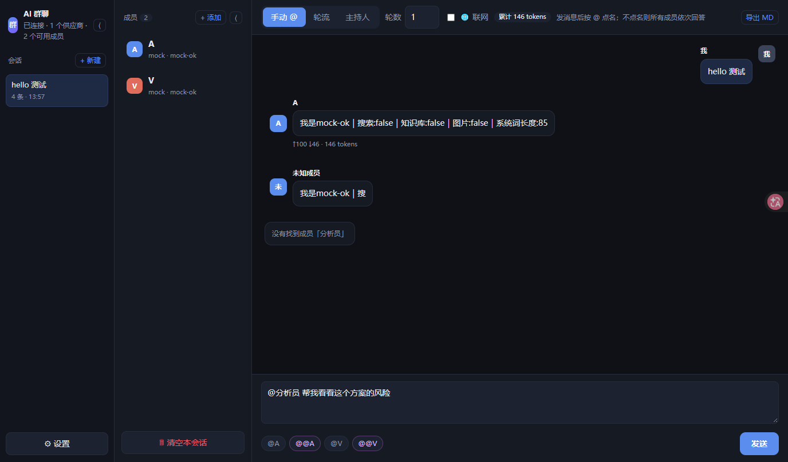
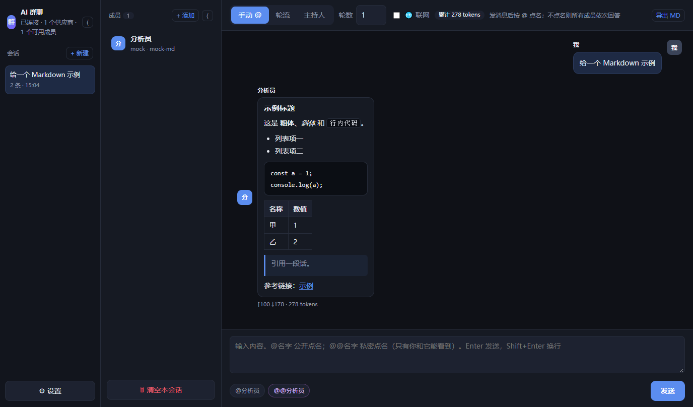

# AI Group Chat 路 Multi-Model Discussion

Put **several LLMs into one conversation** so they can discuss, debate, and cross-check each other 鈥?instead of asking one model at a time.

English | [绠€浣撲腑鏂嘳(README.md)



*Markdown rendering:*



---

## Why

Asking one model gives you one answer with no way to tell whether it is wrong.
This tool lets you put models from different vendors in the same "group chat" so they can:

- **Challenge each other** 鈥?one proposes, another hunts for flaws
- **Split the work** 鈥?different models own different parts
- **Cross-check** 鈥?see several lines of reasoning on the same question

## Two builds

| Build | Location | Highlights |
|---|---|---|
| **Web** (recommended) | [`web/`](web/) | Pure static, no install, works on desktop and mobile, data stays in your browser |
| **Desktop** | [`desktop/`](desktop/) | Windows app (Electron): local folders, native OCR, DPAPI-encrypted keys |

> Live demo: https://thams94.github.io/ai-group-chat/

## Features

| Feature | Web | Desktop |
|---|:---:|:---:|
| Multiple providers (own URL + key each) | 鉁?| 鉁?|
| Personas / temperature / reasoning effort / max tokens per member | 鉁?| 鉁?|
| **Private @** (only you and the mentioned model can see it) | 鉁?| 鉁?|
| Three schedulers: manual @ / round-robin / moderator (rounds 0 = unlimited; moderator selectable and can end the discussion) | 鉁?| 鉁?|
| Streaming output + reasoning trace | 鉁?| 鉁?|
| **Markdown rendering** (headings, lists, tables, code blocks, links; sanitized) | 鉁?| 鉁?|
| Multiple sessions, three-column layout, collapsible sidebars | 鉁?| 鉁?|
| Stop / continue / regenerate / edit messages | 鉁?| 鉁?|
| Local knowledge base (PDF / Word / TXT) | 鉁?multi-file | 鉁?|
| Knowledge-base images | 鉁?vision model or transcription | 鉁?vision model or native OCR |
| Web search | 鉁?| 鉁?|
| Export as Markdown | 鉁?| 鉁?|
| Encrypted key storage | 鈿狅笍 local only | 鉁?DPAPI |

## Quick start

### Web

```bash
cd web
node server.js 8788
# open http://127.0.0.1:8788/
```

On Windows just double-click `web/鍚姩缃戦〉鐗?cmd`.

### Desktop (Windows)

```bash
cd desktop
npm install
npm start
```

Or grab the installer: [AIGroupChat-Setup-0.3.6.exe](https://github.com/Thams94/ai-group-chat/releases/download/v0.3.6/AIGroupChat-Setup-0.3.6.exe) (102 MB, Windows).

### Configure

1. **鈿?Settings** 鈫?**+ Add provider**
2. Enter the API base URL (OpenAI-compatible, e.g. `https://api.example.com/v1`) and key
3. Click **Fetch models** 鈫?Save
4. Click a member 鈫?pick a model, write a persona
5. Type `@name your question`

## Input syntax

| Syntax | Effect |
|---|---|
| `@name text` | Public mention |
| `@@name text` | **Private mention** 鈥?only you and that model can see it |

Keyboard: **Enter** sends, **Shift+Enter** inserts a newline.

## Docs

- [Deployment guide](web/閮ㄧ讲璇存槑.md) 鈥?Nginx, MIME types, CORS, optional proxy
- [Developer guide](web/寮€鍙戣鏄?md) 鈥?architecture, bridge API, extension points
- [Desktop notes](desktop/README.md)

## Privacy

- Requests go **directly** from your client to the API endpoint you configured 鈥?no third-party server
- The code contains **no analytics, no telemetry, no upload logic**
- Keys stay on your machine; avoid public computers

## Known limitations

- Web: knowledge base stores extracted text only; image OCR needs a vision-capable member; search relies on `r.jina.ai` (free tier 鈮?20 req/min, shared)
- Desktop: Windows only; build needs Node 18+

## License

[AGPL-3.0](LICENSE)

> Free to use, modify and distribute. If you run a modified version as a network service,
> you must release your source under AGPL-3.0 as well.

