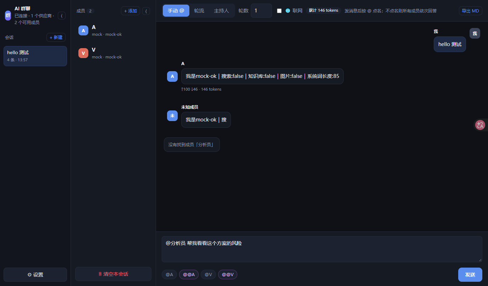
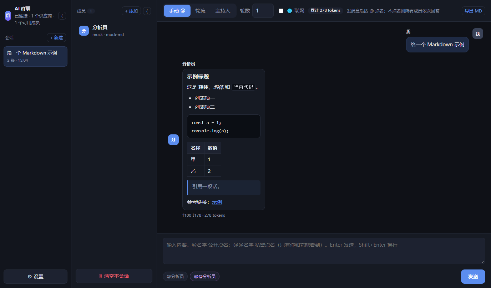

# AI 群聊 · 多模型讨论

**把多个大模型拉进同一个对话**，让它们讨论、辩论、协作，而不是一个个单独问。

[English](README.en.md) | 简体中文



*Markdown 渲染效果：*



---

## 它解决什么问题

平时用 AI 是"一问一答"：你问一个模型，得到一份答案，无法判断它有没有漏洞。
这个工具让你把不同厂商的模型放进一个"群"，让它们：

- **互相挑错**：一个给方案，另一个专门找问题
- **分工协作**：不同模型负责不同环节
- **多视角对照**：同一个问题拿到几种不同思路

## 两个版本

| 版本 | 位置 | 特点 |
|---|---|---|
| **网页版**（推荐） | [`web/`](web/) | 纯静态、无需安装、手机电脑都能用、数据存浏览器本地 |
| **桌面版** | [`desktop/`](desktop/) | Windows 应用（Electron），能读本地文件夹、系统级 OCR、Key 用 DPAPI 加密 |

> 在线体验：https://thams94.github.io/ai-group-chat/

## 功能

| 能力 | 网页版 | 桌面版 |
|---|:---:|:---:|
| 多供应商（各自 URL + Key） | ✅ | ✅ |
| 多成员（人设 / 温度 / 思考强度 / 最大输出） | ✅ | ✅ |
| **私密 @**（只有你和被 @ 的模型可见） | ✅ | ✅ |
| 三种调度：手动 @ / 轮流 / 主持人（轮数 0 = 不限；主持人可选且能宣布结束；到上限可点「继续」） | ✅ | ✅ |
| 流式输出 + 思考过程 | ✅ | ✅ |
| **Markdown 渲染**（标题/列表/表格/代码块/链接，带 XSS 过滤） | ✅ | ✅ |
| 多会话 + 三栏 + 侧栏收起（成员按会话独立保存，新建时继承） | ✅ | ✅ |
| 停止 / 继续生成 / 重新生成 / 编辑 | ✅ | ✅ |
| 本地知识库（PDF / Word / TXT） | ✅ 多选文件 | ✅ |
| 知识库图片 | ✅ 视觉模型或转写 | ✅ 视觉模型或系统 OCR |
| 联网搜索 | ✅ | ✅ |
| 导出 Markdown | ✅ | ✅ |
| Key 加密存储 | ⚠️ 仅本地 | ✅ DPAPI |

## 快速开始

### 网页版

```bash
cd web
node server.js 8788
# 打开 http://127.0.0.1:8788/
```

Windows 直接双击 `web/启动网页版.cmd`。

### 桌面版（Windows）

```bash
cd desktop
npm install
npm start
```

或直接下载安装包：[AIGroupChat-Setup-0.3.5.exe](https://github.com/Thams94/ai-group-chat/releases/download/v0.3.5/AIGroupChat-Setup-0.3.5.exe)（102 MB，Windows）

### 配置

1. 左下 **⚙ 设置** → **+ 添加供应商**
2. 填 API 地址（OpenAI 兼容，如 `https://api.example.com/v1`）和 Key
3. 点 **拉取模型** → 保存
4. 左侧点成员 → 选模型、写人设
5. 输入 `@成员名 你的问题`

## 输入语法

| 写法 | 效果 |
|---|---|
| `@名字 内容` | 公开点名 |
| `@@名字 内容` | **私密点名**，只有你和该成员能看到 |

键盘：**Enter 发送**，**Shift+Enter 换行**。

## 文档

- [使用说明](web/使用说明.md)
- [部署说明](web/部署说明.md)（Nginx / MIME / CORS / 可选反代）
- [开发说明](web/开发说明.md)（架构、接口、改造点）
- [桌面版说明](desktop/README.md)

## 隐私

- 请求由你的浏览器/客户端**直接**发给你自己填的 API，不经过任何第三方服务器
- 项目代码**没有任何上传、打点、遥测**
- Key 只存在你本机；请勿在公共电脑上使用

## 已知限制

- 网页版：知识库只保存解析后的文字；图片 OCR 依赖"支持看图"的成员；搜索走 `r.jina.ai`（免费额度约 20 次/分钟，共享）
- 桌面版：仅 Windows；构建需要 Node 18+

## 许可证

[AGPL-3.0](LICENSE)

> 你可以自由使用、修改、分发；但如果你把修改后的版本作为网络服务提供给他人使用，
> 必须同样以 AGPL-3.0 开放源代码。
