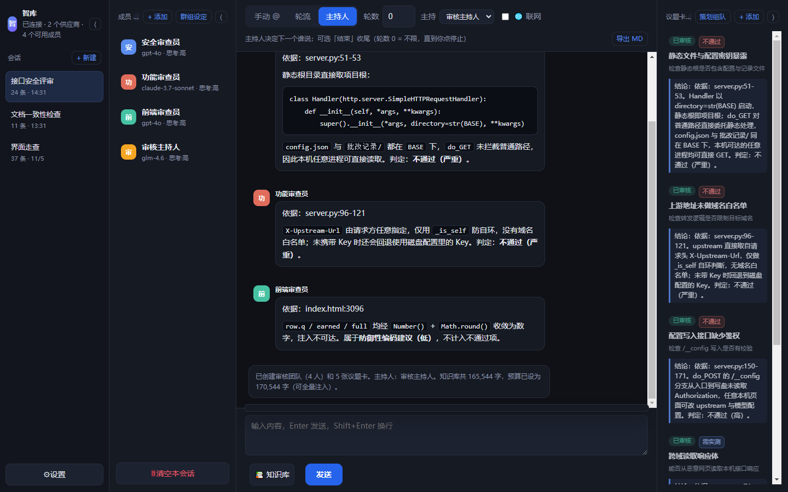
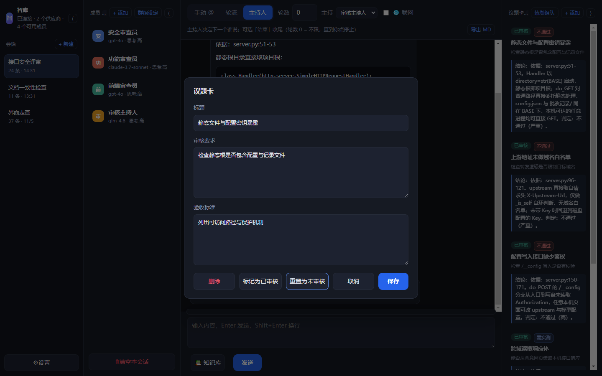
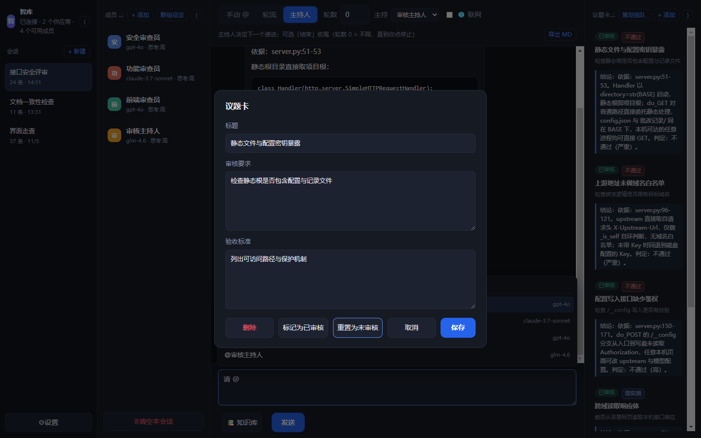
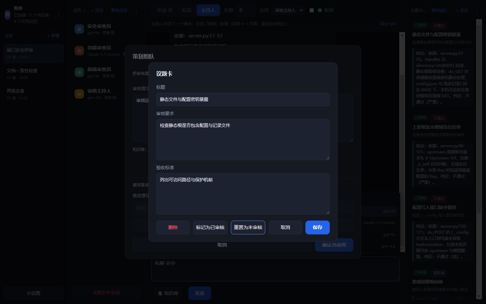
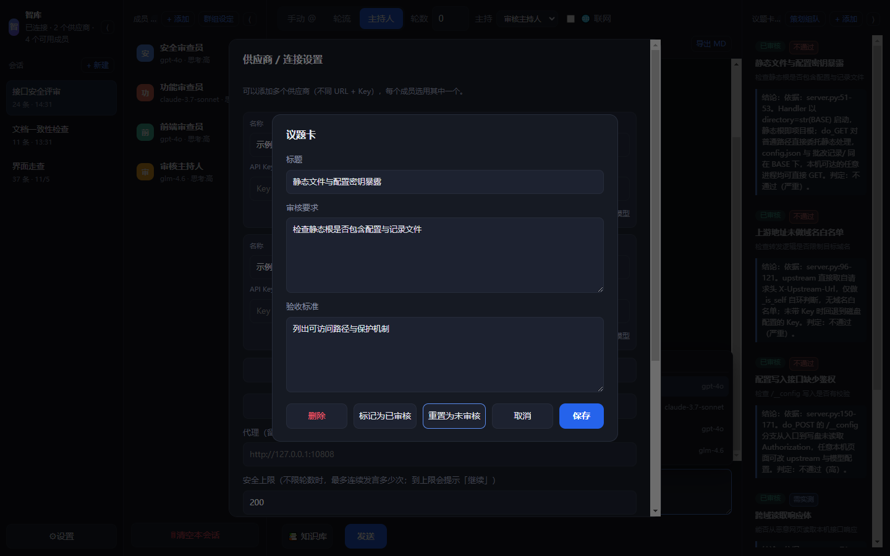
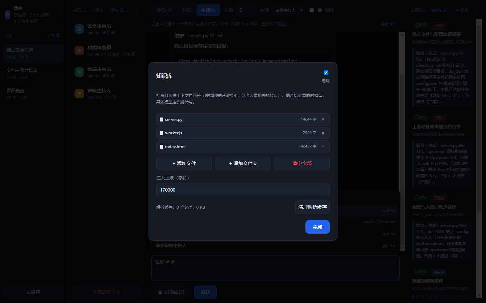
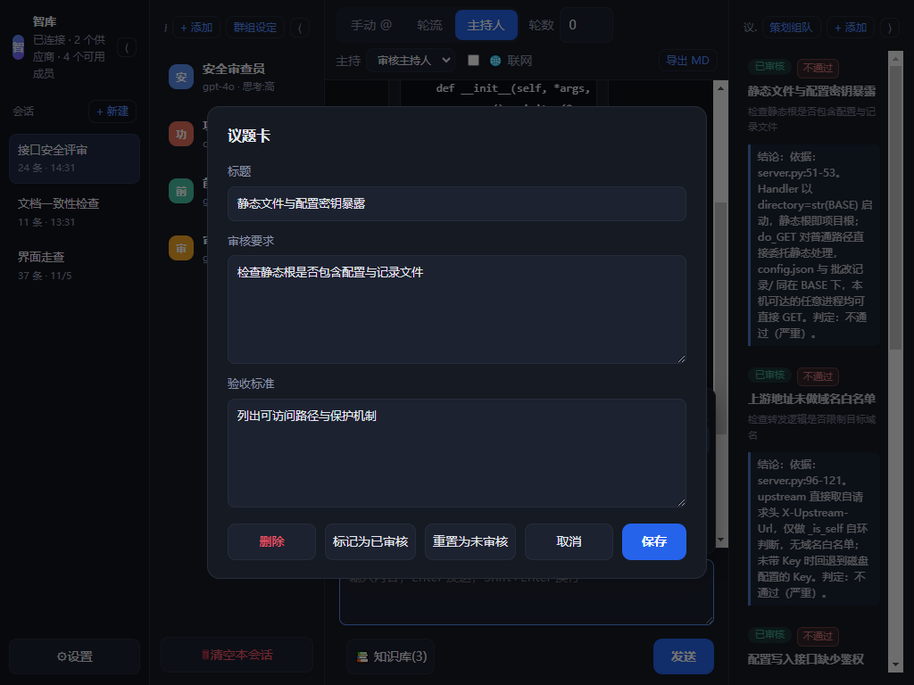

# 智库 Think Tank · 多模型审核工作台

**把多个大模型拉进同一个对话**，让它们讨论、辩论、协作；再用「策划组队 + 议题卡」把它们组成一支审核团队，逐个议题审完并给出**可执行的判定**。

[English](README.en.md) | 简体中文



---

## 它解决什么问题

平时用 AI 是"一问一答"：你问一个模型，得到一份答案，无法判断它有没有漏洞。

这个工具让你把不同厂商的模型放进一个"群"，让它们：

- **互相挑错**：一个给方案，另一个专门找问题
- **分工协作**：不同模型负责不同环节
- **多视角对照**：同一个问题拿到几种不同思路

再加一层**审核工作流**：策划模型先读材料、组团队、拆议题，然后逐张卡审完，每张卡都给判定。

## 审核能给出什么

这是它和普通"多模型聊天"最大的区别：**不接受"证据不足"当结论**。

```
┌────────────┬──────────────────────────────┬──────────────────────┐
│ 类别       │ 判据                         │ 结论形式              │
├────────────┼──────────────────────────────┼──────────────────────┤
│ 静态可判定 │ 完整代码路径里校验存在/不存在 │ 直接判「不通过/通过」 │
│ 静态可推断 │ 逻辑链完整但依赖外部行为     │ 判「高风险」+ 需实测  │
│ 必须实测   │ 取决于浏览器/上游/时序       │ 给最小验证脚本        │
└────────────┴──────────────────────────────┴──────────────────────┘
```

配套机制：

- **材料清单**：每个文件多少行、多少字、是完整注入还是部分注入，都会写进上下文；并明确告知「未注入 ≠ 不存在」
- **按文件保证注入**：小文件整份注入，大文件给「结构大纲 + 头部 + 中段采样 + 尾部」，并标注缺了哪些行
- **全量注入**：按知识库总量自动定预算（1M 上下文模型可一次读完 80 万字符）
- **按议题裁剪**：材料超过预算时，与当前议题最相关的文件优先拿到预算
- **结论必带依据**：每条判定要写「依据：文件名:行号」，风险等级与证据强度必须匹配



## 功能

| 能力 | 网页版 | 桌面版 |
|---|:---:|:---:|
| 多供应商（各自 URL + Key） | ✅ | ✅ |
| 多成员（人设 / 温度 / 思考强度 / 最大输出 / 看图） | ✅ | ✅ |
| **@ 自动补全**：输入 `@` 或 `@@` 就地弹成员列表 | ✅ | ✅ |
| **私密 @**（只有你和被 @ 的模型可见） | ✅ | ✅ |
| 三种调度：手动 @ / 轮流 / 主持人（轮数 0 = 不限） | ✅ | ✅ |
| 流式输出 + 思考过程 | ✅ | ✅ |
| **Markdown 渲染**（标题/列表/表格/代码块/链接） | ✅ | ✅ |
| 多会话 + 三栏（成员 / 知识库 / 群组提示词按会话隔离） | ✅ | ✅ |
| 停止 / 继续生成 / 重新生成 / 编辑 | ✅ | ✅ |
| 本地知识库（PDF / Word / TXT） | ✅ 多选文件 | ✅ 文件 + 文件夹 |
| 知识库图片 | ✅ 视觉模型或转写 | ✅ 视觉模型或系统 OCR |
| 联网搜索 | ✅ | ✅ |
| **策划组队**：自选策划模型，自动生成团队与议题 | ✅ | ✅ |
| **议题卡**：逐卡审核、结论入卡、三档判定徽章 | ✅ | ✅ |
| 暂停 / 继续（不打断当前这条） | ✅ | ✅ |
| 一键拉取全部模型 / 批量高思考 / 批量看图 | ✅ | ✅ |
| 导出 Markdown（按判定分组，含汇总表） | ✅ | ✅ |
| Key 加密存储 | ⚠️ 仅本地 | ✅ DPAPI |

## 两个版本

| 版本 | 位置 | 特点 |
|---|---|---|
| **网页版** | [`web/`](web/) | 纯静态、无需安装、手机电脑都能用、数据存浏览器本地 |
| **桌面版** | [`desktop/`](desktop/) | Windows 应用（Electron），能读本地文件夹、系统级 OCR、Key 用 DPAPI 加密 |

> 在线体验：https://thams94.github.io/think-tank/web/

## 快速开始

### 桌面版（Windows）

下载安装包：[ThinkTank-Setup-0.6.3.exe](https://github.com/Thams94/think-tank/releases/download/v0.6.3/ThinkTank-Setup-0.6.3.exe)（约 103 MB）

或从源码运行：

```bash
cd desktop
npm install
npm start
```

### 网页版

```bash
cd web
node server.js 8788
# 打开 http://127.0.0.1:8788/
```

Windows 直接双击 `web/启动网页版.cmd`。

### 配置

1. 左下 **⚙ 设置** → **+ 添加供应商**
2. 填 API 地址（OpenAI 兼容，如 `https://api.example.com/v1`）和 Key
3. 点 **一键拉取全部模型** → 保存
4. 左侧点成员 → 选模型、写人设
5. 输入 `@` 选成员，或直接 **策划组队** 建一支审核团队

## 输入语法

| 写法 | 效果 |
|---|---|
| `@` | 弹出成员列表，选择后插入 `@名字 ` |
| `@@` | 弹出同一列表，标题为「私密@」，插入 `@@名字 ` |

键盘：**Enter 发送**，**Shift+Enter 换行**；菜单打开时用 `↑` `↓` 选择、`Enter` 确认、`Esc` 关闭。



## 更多截图

| | |
|---|---|
|  |  |
| 策划组队 | 设置（供应商 / 策划模型） |
|  |  |
| 知识库 | 1024 窄屏 |

## 文档

- [使用说明](web/使用说明.md)
- [部署说明](web/部署说明.md)（Nginx / MIME / CORS / 可选反代）
- [开发说明](web/开发说明.md)（架构、接口、改造点）
- [桌面版说明](desktop/README.md)
- [更新日志](CHANGELOG.md)

## 隐私

- 请求由你的浏览器/客户端**直接**发给你自己填的 API，不经过任何第三方服务器
- 项目代码**没有任何上传、打点、遥测**
- Key 只存在你本机；请勿在公共电脑上使用
- 截图中的供应商、地址、会话、议题均为虚构示例

## 已知限制

- **只做静态审核**：只分析你提供的文字/代码/文件，**不会运行被测软件**；需要实测的项会给出验证脚本，由你执行
- 大文件中段可能被截断：会明确标注「只注入了第 X–Y 行」，不会假装读过
- 网页版：知识库只保存解析后的文字；搜索走 `r.jina.ai`（免费额度约 20 次/分钟）
- 桌面版：仅 Windows；构建需要 Node 18+

## 许可证

[AGPL-3.0](LICENSE)

> 你可以自由使用、修改、分发；但如果你把修改后的版本作为网络服务提供给他人使用，
> 必须同样以 AGPL-3.0 开放源代码。
